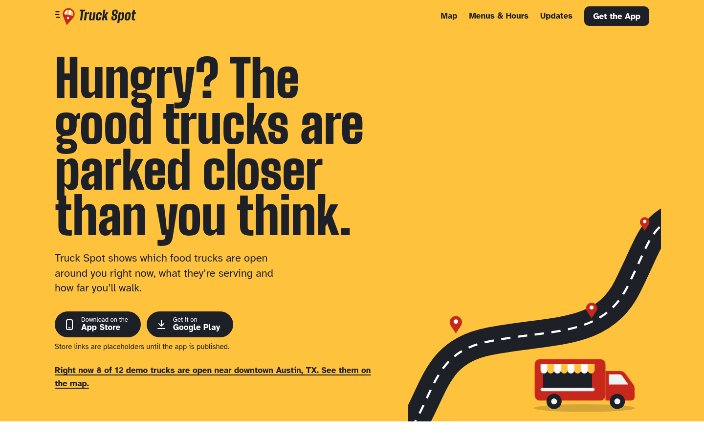

# Truck Spot: logo and landing page

Logo system and single-scroll landing page for **Truck Spot**, a mobile app that shows hungry people the food trucks open around them in real time. Built as a **working static site**, not a mockup: the map, ticket list, filters, “open now” logic, location button and email opt-in all run in the browser.

- **Live page:** https://moltidenchi.github.io/truck-spot-landing/
- **Style guide (design handoff):** https://moltidenchi.github.io/truck-spot-landing/style-guide.html
- **Production zip:** attached to the [latest release](https://github.com/moltidenchi/truck-spot-landing/releases/latest)
- **Screenshots:** [`shots/`](shots/)

Freelancer.com contest entry for “Truck Spot Logo & Landing Page”, built with AI assistance. If this entry wins, the rights to the design transfer to the contest holder under the contest terms.



## Concept

Truck Spot is about three things: finding a spot, street food, and movement. The logo is a **map pin leaning forward into the direction of travel**, with a **scalloped food-truck awning** in its head and three speed lines trailing behind it. The wordmark is Big Shoulders Display Black, a condensed face drawn from Chicago’s street signage, slanted 8° to match the lean of the pin.

The palette is the street-food counter: **mustard** for big, happy surfaces, **ketchup** for the things you act on, and **asphalt** as ink. The page borrows two pieces of food-truck vernacular: the hero is a road with a truck pulling up (one short animation, off for reduced-motion users), and each truck in the list is an **order ticket** with a perforated top edge and dotted menu leaders.

| Token | Hex | Role |
| --- | --- | --- |
| Asphalt | `#1D2127` | text, dark surfaces, wordmark |
| Ketchup | `#C8281B` | logo pin, primary actions, links (5.6:1 on white) |
| Mustard | `#FFC23C` | hero and header, awning stripes, links on dark |
| Curb / Fog | `#FFFFFF` / `#F1F2F4` | surfaces |
| Kerb | `#59616C` | secondary text, input borders (6.3:1 on white) |
| Lettuce / Amber | `#1E7A46` / `#8A4B00` | open now / closing soon |

Type: **Big Shoulders Display** (headlines, truck names) and **Atkinson Hyperlegible** (body and UI; designed for maximum legibility, which helps on small screens outdoors). Both are SIL OFL, self-hosted, no font CDN.

## Brief checklist

| Brief | Where |
| --- | --- |
| Logo: movement, street food, easy discovery; readable small | `assets/logo/svg/`, style guide “Logo” section |
| Vector + PNG, colour and mono, horizontal, icon-only | 12 SVGs (horizontal, stacked, icon, each in colour / on-dark / mono black / mono white, plus app icon and favicon) and 24 transparent PNGs in `assets/logo/png/` |
| Favicon versions | `assets/favicon/`: `favicon.ico` (16/32/48), `favicon.svg`, 16/32/48 PNG, `apple-touch-icon-180.png`, `icon-192.png`, `icon-512.png`, `site.webmanifest` |
| Hero with logo, value statement, app-store buttons | `index.html` hero; store buttons are in-house placeholders (no official badges), links marked as placeholders |
| Interactive map of nearby trucks | Leaflet 1.9.4 (vendored) + OpenStreetMap tiles with attribution, no API key; 12 fictional trucks; “Use My Location” with fallback to downtown Austin, TX |
| Browse menus and hours | Ticket list beside the map: menu, weekly hours table, live “open now” status, distance, cuisine filter, open-now toggle; clicking a ticket flies the map to its pin and opens it; clicking a pin highlights its ticket; `#truck-<id>` links are shareable |
| Email opt-in | Client-side validation, error text, success state; demo only, nothing sent or stored |
| Responsive, accessible, fast | Tested at 320–1440 px; semantic landmarks, skip link, labels, live regions, visible focus, WCAG AA contrast (tested), reduced motion; about 130 KB of first-party code, fonts and logos plus 160 KB of Leaflet (roughly 45 KB gzipped) before map tiles; no framework, no build step |
| Figma / XD / Sketch | Not produced. Instead: `style-guide.html`, `docs/design-tokens/tokens.json` (W3C design tokens) and `tokens.css`, organised `assets/`, see “Design handoff” |
| Production-ready zip | `bash tools/make_dist.sh`, attached to the GitHub release |

## Run it locally

No build step. The page uses ES modules, so serve it over HTTP rather than opening the file directly:

```bash
python3 -m http.server 8000      # then open http://localhost:8000/
```

Tests (Node 20+, no install needed for the unit tests):

```bash
npm test                         # node:test: hours/open-now logic, email validation, geo helpers,
                                 # token sync + WCAG contrast, links/CSP/privacy/data checks
npm ci && npm run lint:html      # html-validate 11.21.0 (pinned) on both pages
bash tests/browser_check.sh      # optional: headless Chrome CLI smoke test (map tiles, 12 pins and
                                 # tickets, no console errors or CSP violations)
```

## Files

```
index.html                 landing page
style-guide.html           design handoff: logo variants, palette, type, components, files
site.webmanifest           PWA manifest / icons
assets/css/tokens.css      generated CSS custom properties (from tokens.json)
assets/css/fonts.css       @font-face, self-hosted
assets/css/site.css        page styles (only token values, no raw colours)
assets/css/style-guide.css style-guide page only
assets/js/app.js           page behaviour (map, tickets, filters, location, opt-in)
assets/js/hours.js         opening-hours logic (pure, unit tested)
assets/js/email.js         email validation (pure, unit tested)
assets/js/geo.js           distance and offset helpers (pure, unit tested)
assets/js/trucks.js        SYNTHETIC demo data
assets/logo/svg|png/       logo files
assets/favicon/            favicon set
assets/fonts/              WOFF2 + OFL licences
assets/img/og-image.png    social preview image
assets/vendor/leaflet-1.9.4/  pinned Leaflet + licence
docs/design-tokens/        tokens.json (source of truth), tokens.css
tools/                     build_tokens.mjs, build_logo.py, build_fonts.py, export_png.py, shots.py, make_dist.sh
tests/                     node:test suites and the headless browser check
shots/                     screenshots
```

## Design handoff

There is no Figma, XD or Sketch file in this entry; rather than export a hollow one, the handoff is the working system:

- **`style-guide.html`** shows every logo variant on the backgrounds it is meant for, clear-space and minimum-size rules, the palette with contrast ratios, the type scale, and the live components (buttons, store buttons, chips, status labels, email field incl. error state, map pins, ticket, spacing scale).
- **`docs/design-tokens/tokens.json`** is the single source of truth in the W3C Design Tokens format, so it imports into Figma with a tokens plugin (for example Tokens Studio) or into Style Dictionary. `node tools/build_tokens.mjs` regenerates `tokens.css` and the style-guide palette from it; `npm test` fails if they drift.
- **Logo sources** are generated by `tools/build_logo.py` from plain geometry plus the outlined wordmark, so changing a colour or the lean angle is a one-line edit; `tools/export_png.py` re-exports all PNGs and the favicon set with headless Chrome.

## Making it real

### Swap in real data

`assets/js/trucks.js` exports `DEFAULT_CENTER` and `TRUCKS`. Each truck is `{ id, name, cuisine, blurb, menu: [[item, price]], hours, offset: [east_m, north_m] }`. For live data, replace `offset` with real coordinates and load the list from your API, then call the existing render path:

```js
// in app.js computeTrucks(): use t.lat/t.lng instead of offsetLatLng(state.center, ...)
const res = await fetch("/api/trucks?lat=..&lng=..");   // add your API origin to connect-src in the CSP
```

`hours` uses `{ mon: [["11:00", "14:30"], ["17:00", "21:30"]], ... }`; ranges that end after midnight (`["18:00", "02:00"]`) are supported. Hours are evaluated in the visitor’s local time; for trucks in other time zones, add a `timeZone` field and convert before calling `statusAt`.

### Swap the map provider

The OSM Foundation tile servers are fine for a demo but not for a launched product. Change the URL in `initMap()` in `assets/js/app.js` (for example MapTiler, Stadia Maps, Thunderforest, or self-hosted tiles), keep the provider’s attribution, and add its tile host to `img-src` in the page’s Content-Security-Policy meta tag. A key for a client-side tile provider should be a restricted, referrer-locked public key.

### Wire up the email opt-in

The form currently validates in the browser and shows a success state without sending anything (`initOptIn()` in `app.js`). To go live:

- **Formspree / Basin / similar:** set `action="https://formspree.io/f/<form-id>" method="POST"` on the form, add that origin to `form-action` (and `connect-src` if you submit with `fetch`) in the CSP, and replace the demo block in `initOptIn()` with a `fetch(form.action, { method: "POST", body: new FormData(form), headers: { Accept: "application/json" } })` that shows the success state on `res.ok` and the error text otherwise.
- **Mailchimp:** use the embedded-form URL from Audience → Signup forms (the `.../subscribe/post?u=...&id=...` action), keep its hidden honeypot field, and post the form the same way; or call your own backend that uses the Mailchimp Marketing API so the API key stays server-side.
- Before launch: use double opt-in, link a privacy notice next to the field, and store consent time and source. Never put a private API key in this static site.

### Store buttons

The store buttons are in-house placeholders and intentionally not the official badges. When the app is listed, replace them with the official “Download on the App Store” and “Get it on Google Play” badges following Apple’s and Google’s badge guidelines, and put the real store URLs in the `href`s (the click handler that announces “placeholder” is in `initStoreButtons()`).

## Security and privacy

- Strict Content-Security-Policy meta on both pages: `script-src 'self'`, `style-src 'self'`, no inline scripts or styles, images only from the site and `tile.openstreetmap.org`, `object-src 'none'`. Checked by `tests/site.test.mjs` and the headless check (no CSP violations logged).
- No cookies, no analytics, no third-party scripts or fonts. The only third-party requests are OSM map tiles.
- Location is requested only when the visitor presses “Use My Location”, used in the browser to place the demo, and never sent anywhere.
- All data is fictional; no personal data is in the repository (checked by the test suite).

## Licence

Code: MIT (see `LICENSE`). Third-party components and fonts: see `CREDITS.md`. Logo and design: contest entry; if it wins, rights transfer to the contest holder under the Freelancer.com contest terms.
